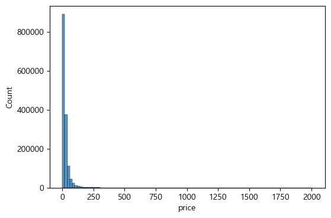
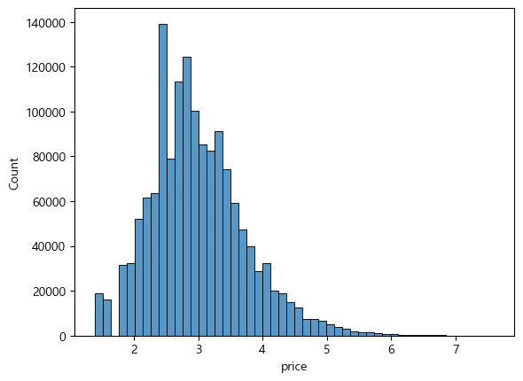
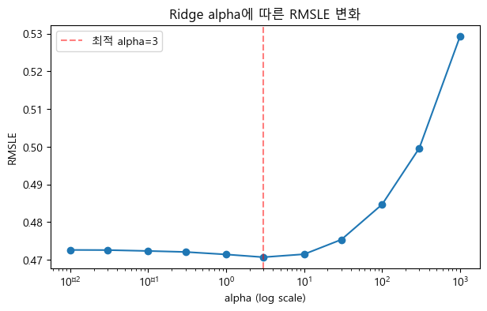
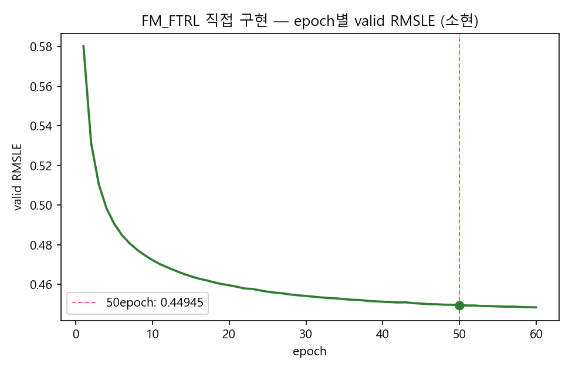
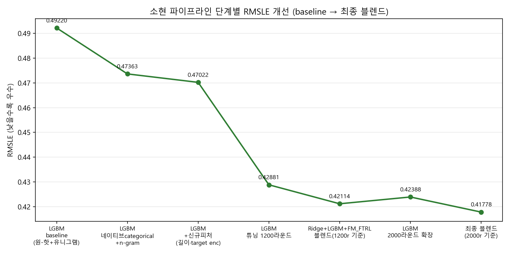

# Mercari Price Prediction

**중고거래 상품 가격 예측 — 희소 텍스트 피처 회귀 모델링**

<p>
  
  
  
  
  
</p>

> **RMSLE 0.49220 → 0.41778 (15.1% 개선)**
> 148만 건의 중고거래 데이터에서 상품명·설명글·카테고리·브랜드로 판매가를 예측한다.
> Ridge/LightGBM 비교 → 인코딩·n-gram 개선의 원천 분리 → FM-FTRL 직접 구현 →
> leakage-free 2-stage 블렌딩까지, 각 단계를 실측으로 검증하며 진행했다.

> **English summary** — Price regression on 1.48M Mercari marketplace listings using sparse text
> features (name / item description) plus categorical and numeric blocks. Worked the score from
> RMSLE 0.49220 down to 0.41778 (−15.1%) through ablation-driven iteration: Ridge vs LightGBM
> baselines, separating the gains of native categorical encoding from n-gram expansion, a
> from-scratch FM-FTRL implementation in NumPy/SciPy, and a leakage-free 2-stage blend.

---

## 문제 정의

| | |
|---|---|
| **데이터** | Kaggle *Mercari Price Suggestion Challenge* · `(1,482,535 × 8)` |
| **입력** | 상품명, 상품 설명글, 카테고리(계층), 브랜드, 상품 상태(1~5), 배송비 부담 여부 |
| **타깃** | `price` (판매가) |
| **평가지표** | RMSLE — 가격처럼 왜도가 큰 타깃에서는 절대오차보다 로그오차가 합리적 |

**첫 설계 선택이 이후 전부를 단순하게 만들었다.** 타깃을 미리 `log1p`로 변환해두면
일반 회귀모델의 RMSE 최소화가 **수학적으로 RMSLE 최소화와 동일**해진다. 덕분에 RMSLE 전용
손실함수를 따로 만들 필요 없이 표준 회귀 파이프라인을 그대로 쓸 수 있었다.

## 데이터에서 먼저 확인한 것

<p align="center">
  
  
</p>

- `price` 분포가 오른쪽으로 심하게 치우쳐 있다 (min 0, max 2009, mean ≈ 26.7) → `log1p` 변환 근거
- `price == 0` 행 존재 (증정품·입력 오류 추정) → 노이즈로 제거
- 2000달러 이상 극단 고가 → 이상치로 제거
- **`brand_name` 결측이 632,682건 (전체의 약 43%)** → 결측을 버리는 대신 "브랜드 없음"이
  가격에 주는 영향을 따로 측정했다 ([`figures/06`](figures/06_null_penalty_price_barplot.png))
- `category_name`은 `대분류/중분류/소분류` 구조 → 분할 시 유니크 11 / 114 / 871개

전처리는 `(1482535, 8)` → `price > 0` → `price < 2000` 순으로 적용했다.

## 모델링 — 3가지 전략을 각각 실측

같은 피처 구성(`X_features`: name/desc 유니그램 + 범주형 원-핫 + 수치형, 5,804차원)을
고정하고 전략별로 비교했다.

| | 모델 | RMSLE | 비고 |
|---|---|---|---|
| 🥇 | **Ridge** (`alpha=3`) | **0.47067** | alpha 그리드 탐색 결과 baseline이 이미 최적 |
| 🥈 | **LightGBM** (native categorical + n-gram) | **0.47363** | 원-핫 → native 인코딩 교체로 끌어올림 |
| 3 | LightGBM (단일, 원-핫 + 유니그램) | 0.49220 | baseline |
| 4 | 단계적 잔차 LightGBM — **실패, 보류** | 0.49735 | 우선순위 피처 → 잔차 2단계. 가장 나빴다 |

**실패한 전략도 그대로 남겼다.** 4번(단계적 잔차 LGBM)은 아이디어는 그럴듯했지만 baseline보다
나빴고, 노트북에 주석 처리된 채로 두고 설계 문서에 왜 실패했는지 적었다.

같은 피처에서 **Ridge가 LightGBM보다 확실히 우수**했다 (0.47067 vs 0.49220). 고차원 희소
텍스트 행렬에서는 선형 모델이 유리하다는 신호로 읽고, 트리 모델 쪽 격차를 줄이는 방향으로 넘어갔다.

### 개선의 원천을 분리했다

LightGBM을 `0.49220 → 0.47363`으로 올린 요인이 두 개 섞여 있었다 — (a) 범주형 원-핫 → native
categorical 인코딩, (b) 유니그램 → n-gram(1,2) 확장. **어느 쪽이 실제로 기여했는지 따로 측정했다.**

| 조건 | 카테고리 인코딩 | 텍스트 | 피처 수 | RMSLE |
|---|---|---|---|---|
| A (baseline 재현) | 원-핫 | 유니그램 | 55,807 | 0.49180 |
| B (카테고리만 교체) | **native** | 유니그램 | 50,007 | **0.47409** |

**개선은 거의 전부 (a) 인코딩에서 나왔다.** n-gram 확장의 기여는 미미했다. 피처 수도 오히려
줄어드는데 성능이 올라갔다 — 원-핫이 트리 분기를 비효율적으로 쪼개고 있었다는 뜻이다.

vocab 크기(`max_features`) 민감도도 함께 확인했는데, 50,007차원(0.47320)에서
1,968,091차원(0.47293)까지 늘려도 차이가 거의 없었다. **어휘를 키우는 방향에는 남은 성능이 없었다.**

<p align="center"></p>

### FM-FTRL을 직접 구현했다

여기까지는 "같은 피처에 다른 모델"이었다. 실질적 개선은 **모델 축을 하나 더 추가**하면서 나왔다.

이 대회에서 잘 알려진 접근은 `Wordbatch` 패키지의 FTRL + FM_FTRL + LightGBM 블렌드다
(공개 커널 LB 0.42555). 그런데 **`wordbatch`는 Python 3.13용 wheel이 없고 이 환경에는 C 컴파일러도
없어 설치가 불가능했다.** 우회하는 대신 같은 알고리즘을 직접 구현했다:

- **선형항** — McMahan et al., *"Ad Click Prediction: a View from the Trenches"* (2013)의
  FTRL-proximal 업데이트 (좌표별 적응 학습률 + L1/L2)
- **2차 상호작용항** — 표준 FM 트릭 `0.5·Σ_f[(Σ_i v_if x_i)² − Σ_i v_if² x_i²]` (latent `k=8`)을
  미니배치 전체에 대해 **sparse @ dense 행렬곱으로 벡터화** (행 단위 Python 루프 없음), AdaGrad 학습
- 미니배치 5만 행마다 `X_b.T @ (G*S) − (X_b²).T @ G * V` 로 그래디언트 계산 — nnz에 비례하는
  비용이라 148만 행에서도 epoch당 수 초
- 실제 FM 구조를 가진 합성 데이터로 **스모크 테스트**를 먼저 통과시켜(발산·NaN 없이 loss 단조 감소)
  구현이 맞는지 확인한 뒤 실데이터에 적용

구현은 `notebook/` 18번 섹션의 `class FMFTRL`이다. Wordbatch의 Cython 최적화 구현만큼 빠르지는
않지만 수학적으로 같은 모델이다.

<p align="center"></p>

여기에 길이 피처와 target encoding을 추가하고, **leakage 없는 2-stage 블렌딩**으로 Ridge ·
LightGBM · FM-FTRL을 결합했다. 마지막으로 LightGBM `n_estimators`를 1200 → 2000으로
이어학습해 **최종 RMSLE 0.41778**에 도달했다.

<p align="center"></p>

**맥락을 위한 참고 수치** — 이 대회의 유명한 Wordbatch 공개 커널은 Kaggle LB RMSLE 0.42555,
역대 1위(Sparse MLP 앙상블)는 0.3875다. 다만 **이 저장소의 0.41778은 자체 train/test 분할 기준이고
Kaggle LB 점수가 아니므로 직접 비교할 수 없다** — 평가 데이터와 분할 방식이 다르다.
수치의 규모가 어느 정도인지 가늠하는 참고로만 적는다.

### Leakage는 숨기지 않고 측정했다

전처리를 전체 데이터 기준으로 한 번에 수행하고 train/test 분할을 모델 학습 직전에만 했다 —
어휘가 학습에 살짝 새어 들어가는 leakage다. **그대로 두는 대신 영향을 실측했다**:
Ridge 0.46774 vs 0.46806, LightGBM 0.49666 vs 0.49696 — 실측 영향이 미미함을 확인하고,
실용적 단순화로 채택한다는 근거를 문서에 남겼다. 최종 블렌딩 단계는 leakage-free로 다시 구성했다.

## 설계 문서

[`docs/PIPELINE.md`](docs/PIPELINE.md) (약 40KB) — **노트북과 이 문서만 있으면 파이프라인을
처음부터 재구현할 수 있는 것**을 목표로 쓴 설계 문서다. 데이터 특성 → 전처리 단계별 shape 변화 →
피처 엔지니어링 → 전략별 실측 → 실패 원인 → 재현 방법 순으로 정리했고, 각 선택의 근거를 적었다.

## 구조

```text
notebook/mercari_price_prediction.ipynb   # 전체 파이프라인 (89셀, 출력 포함 — 열면 결과가 보인다)
docs/PIPELINE.md                          # 설계 문서 (데이터·전처리·피처·모델·실패 기록)
docs/PIPELINE_feature.md                  # 피처 확장 계획
figures/                                  # EDA·실험 결과 그래프 9장
report/experiment_sheet.pdf               # 실험 기록 시트
```

## 재현

데이터는 용량 때문에 포함하지 않았다 (`.gitignore`). Kaggle
*Mercari Price Suggestion Challenge* 의 `train.tsv`를 `data/mercari_train.tsv`로 두면 된다.

```bash
pip install pandas numpy scipy scikit-learn lightgbm matplotlib seaborn
jupyter notebook notebook/mercari_price_prediction.ipynb
```

노트북은 **출력이 저장된 상태**라 실행하지 않고 GitHub에서 바로 열어도 모든 결과와 그래프가 보인다.

## 출처 및 기여 범위

5인 팀 프로젝트(ML/데이터 분석 과정)의 **Mercari 회귀 과제 부분을 분리한 저장소**다.
원본: [`Hyehyun1001/ml-data-analysis`](https://github.com/Hyehyun1001/ml-data-analysis) · `KSH` 브랜치

이 저장소에는 **김소현 본인이 작성한 것만** 담았다 — 위 노트북, 설계 문서, 그래프, 실험 시트.
커밋 히스토리 16개(2026-08-26 ~ 08-31)도 원본 작성일 그대로 보존했다.
팀원들이 각자 작성한 노트북과 팀 공동 최종 리포트는 공동 저작물이므로 포함하지 않았다.

**김소현 (Sohyun Kim)**
